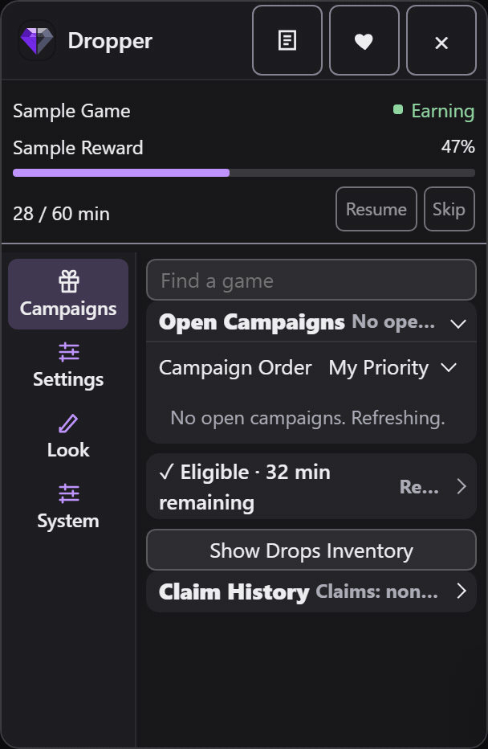

#  Dropper for Twitch

Track Twitch Drops progress, campaign eligibility and inventory from one menu.

[Install Dropper for Twitch](https://github.com/ExtraPotions/Dropper/releases/latest/download/dropper.user.js) · Requires [Violentmonkey](https://violentmonkey.github.io/get-it/) or [Tampermonkey](https://www.tampermonkey.net/).

After installing, sign in to Twitch, refresh, and open Dropper in Twitch’s top bar. [Setup and controls →](docs/usage.md)

## Features

- Track credited watch time and check stream eligibility for the current reward.
- Browse campaigns, review reward history and open your Drops inventory.
- Choose games and manage stream-switching preferences.
- Adjust Twitch’s site colors and the progress card.

Twitch determines eligibility and credit. Saved choices, manual stream holds and pauses are respected; additional browsing tabs stay where you open them.

## See it in action

More screenshots

Screenshots use sample content.

---

[Usage](docs/usage.md) · [Changelog](CHANGELOG.md) · [Support](https://ko-fi.com/expdare) · [Code license](LICENSE-CODE.md) · [Artwork and documentation license](LICENSE-ASSETS.md)

Donations are optional. All features remain available without donating.

Dropper is independent and is not affiliated with or endorsed by Twitch.
