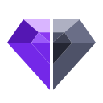
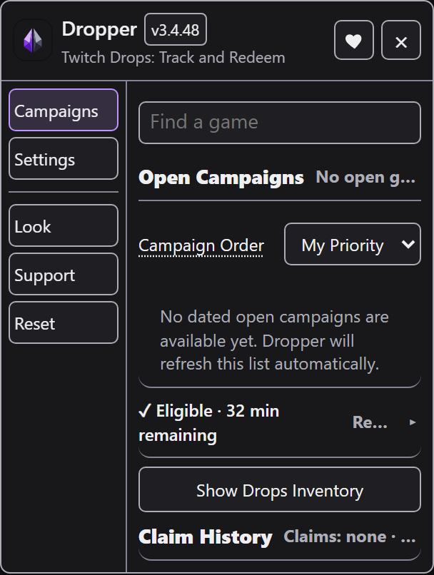
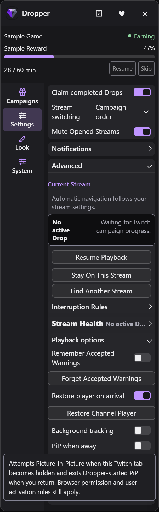

# Dropper

**Your Drops at a glance**

## Get started

1. Install a userscript manager such as [Violentmonkey](https://violentmonkey.github.io/get-it/) or [Tampermonkey](https://www.tampermonkey.net/).
2. [Install Dropper](https://github.com/ExtraPotions/Dropper/releases/latest/download/dropper.user.js) and confirm in your userscript manager.
3. Sign in to Twitch, refresh, and open the Dropper launcher in Twitch's top bar. With other ExtraPotions products installed, they share one launcher: open it and choose Dropper.

Stream switching starts at **Follow campaign order** in the first eligible tab. Saved choices, manual stream holds and pauses are respected; additional browsing tabs stay where you open them. Change the policy in **Settings → Stream switching**.

## What you can do

- **Track progress:** see credited watch time for the current reward on a compact card. Opening the menu moves the same card inside it. When the menu is closed and chat's leaderboard is available, the expanded card replaces that space; Hide progress card restores the leaderboard. Badge Only collapses the card until you open it. Pause or Resume reflects your viewing intent; Skip asks for confirmation. Twitch decides eligibility and credit.
- **Check eligibility:** see whether the stream you are watching matches the campaign: account, campaign, reward, game, and stream.
- **Keep rewards in reach:** browse campaigns, review your history, and open your Drops inventory from the menu.
- **Choose your games:** follow the games you care about and ignore the rest.

## See it in action

<table>
  <tr>
    <td width="50%" valign="top" align="center"> <strong>Campaigns and inventory</strong></td>
    <td width="50%" valign="top" align="center"> <strong>Settings: Advanced and playback</strong></td>
  </tr>
</table>

Screenshots use sample content.

All ExtraPotions menus share the same Core template. Open **System** for status, diagnostics, troubleshooting and Reset. Donations remain in the header heart.

## Support

[Support development](https://ko-fi.com/expdare). Donations are optional. All features remain available without donating.

## License

**Code:** [PolyForm Noncommercial License 1.0.0](LICENSE-CODE.md) 
**Artwork and documentation:** [CC BY-NC-SA 4.0](LICENSE-ASSETS.md)

Dropper is an independent project and is not affiliated with or endorsed by Twitch.
