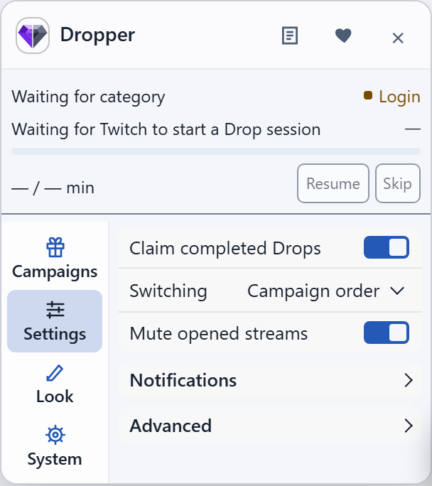
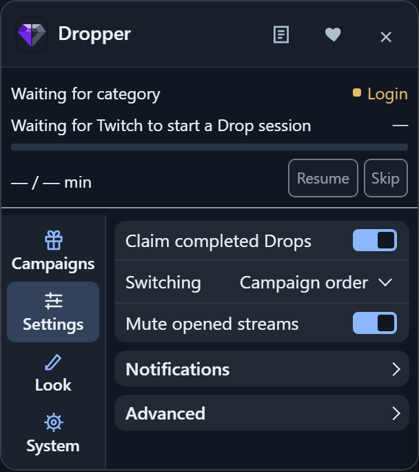
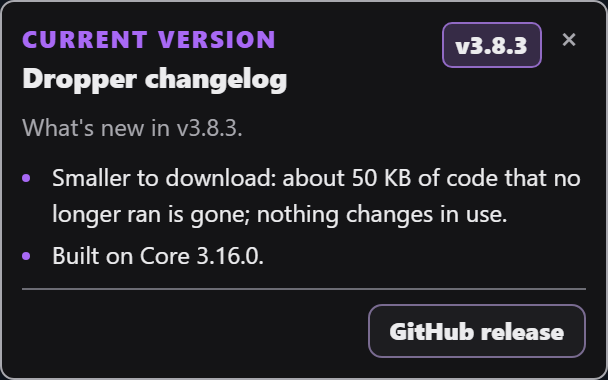

#  Dropper for Twitch

Track Twitch Drops progress, campaign eligibility and inventory from one menu.

[Install Dropper for Twitch](https://github.com/ExtraPotions/Dropper/releases/latest/download/dropper.user.js) · Requires [Violentmonkey](https://violentmonkey.github.io/get-it/) or [Tampermonkey](https://www.tampermonkey.net/).

After installing, sign in to Twitch, refresh, and open Dropper in Twitch’s top bar. [Setup and controls →](docs/usage.md)

## Features

- Track credited watch time for the current reward on a compact card in the Stream Chat title bar, and check stream eligibility.
- Browse campaigns, review reward history and open your Drops inventory.
- Choose games and manage stream-switching preferences.
- Choose Light, Dark or System for the menu and for a Slate Blue Twitch theme.

Twitch determines eligibility and credit. Saved choices, manual stream holds and pauses are respected; additional browsing tabs stay where you open them.

## Screenshots

| Light | Dark | Changelog |
| :---: | :---: | :---: |
|  |  |  |

---

[Usage](docs/usage.md) · [Changelog](CHANGELOG.md) · [Support](https://ko-fi.com/expdare) · [Code license](LICENSE-CODE.md) · [Artwork and documentation license](LICENSE-ASSETS.md)

Donations are optional. All features remain available without donating.

Dropper is independent and is not affiliated with or endorsed by Twitch.
Menus are charcoal with purple highlights in Light, Dark or System mode. Site themes use Slate Blue in the same three modes.
